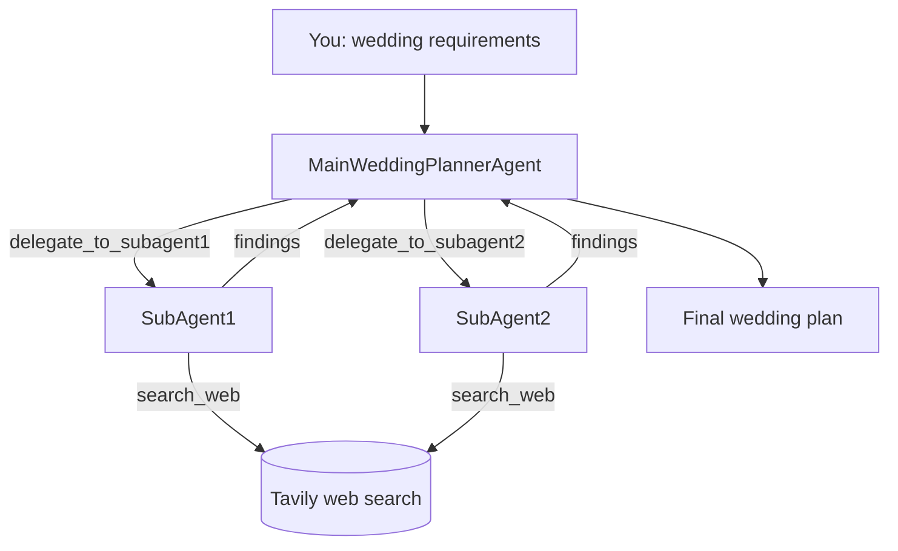

# Multi-Agent Wedding Planner

A multi-agent AI app built with [LangChain](https://docs.langchain.com/). You describe the wedding you want, and a **main planner agent** sends research tasks to two **web-search subagents**. It then combines what they find into a wedding plan: venues, budget breakdown, vendors and next steps.

This project is for learning how agents hand work to other agents (the *supervisor / subagent* pattern).

## How it works



1. The app asks for your requirements and puts them into the main agent's system prompt.
2. The **main agent** decides what it needs to know and calls a subagent through a tool (`delegate_to_subagent1` / `delegate_to_subagent2`).
3. Each **subagent** is a separate agent with one tool, `search_web`. That tool calls the Tavily API and returns the top 5 results as title, URL and snippet.
4. Each subagent's answer goes back to the main agent as a tool result. The main agent then writes the final plan.

All three agents use the same LLM, defined once in `models.py`.

## Project structure

```
src/multi_agent_acl/
├── __init__.py   # main(): asks for requirements, builds and runs the main agent
├── agents.py     # the two subagents + the tools that delegate to them
├── tools.py      # search_web tool (Tavily)
├── models.py     # the LLM all agents share
└── prompt.py     # system prompt and user prompt for the main agent
```

## Prerequisites

- [uv](https://docs.astral.sh/uv/) (installs Python 3.14 for you if needed)
- API keys. All of these have free tiers:
  - **Groq**: [console.groq.com](https://console.groq.com) (the default LLM)
  - **Tavily**: [tavily.com](https://tavily.com) (web search)
  - **Gemini** (optional): [aistudio.google.com](https://aistudio.google.com)

## Setup

```bash
git clone https://github.com/abhishekm2106/multi-agent-acl.git
cd multi-agent-acl
uv sync
```

Create a `.env` file in the project root:

```env
GROQ_API_KEY="gsk_..."
TAVILY_API_KEY="tvly-..."
GEMINI_API_KEY="..."        # only needed if you switch to Gemini
```

`.env` is in `.gitignore`. Never commit it.

## Run

```bash
uv run multi-agent-acl
```

When prompted, describe your wedding, for example:

```
Beach wedding in Goa, 100 guests, budget 15 lakh INR, December
```

Log lines show which agent is doing what:

```
INFO | invoking main wedding planner agent...
INFO | Delegating query to SubAgent1: Beach wedding venues in Goa for 100 guests...
INFO | Searching the Web for topic: beach wedding venues Goa capacity 100 guests...
```

A run takes about a minute on the free tiers.

## Switching the LLM

Edit `src/multi_agent_acl/models.py`. The string format is `"provider:model-name"`:

```python
ai_model = init_chat_model("groq:openai/gpt-oss-120b")            # default
# ai_model = init_chat_model("google_genai:gemini-3.8-flash")     # Gemini
```

Pick a model that supports **tool calling**, because the agents can't delegate or search without it.

## Free-tier limits

| Provider | Limit | What you'll see |
|---|---|---|
| Groq | Tokens per minute | `Retrying request ... in N seconds`. The library waits and retries on its own. |
| Gemini | About 20 requests **per day** per model | `429 RESOURCE_EXHAUSTED`. Switch models or wait for the reset. |

One run makes several LLM calls: the main agent, each subagent, and each step after a tool result. A few runs can use up a daily quota.

## Known limitations / ideas

- The model doesn't know today's date, so it may plan for the wrong year. Add the current date to the prompt in `prompt.py`.
- The two subagents are identical. Give them different jobs, such as venues and vendors, with their own system prompts.
- Only one turn: you can't ask follow-up questions yet.

## Tech stack

[LangChain](https://docs.langchain.com/) (`create_agent`) · [Groq](https://groq.com) / [Gemini](https://ai.google.dev) · [Tavily](https://tavily.com) · [uv](https://docs.astral.sh/uv/)
